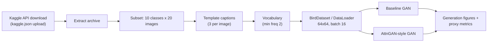

# AttnGAN-Inspired Bird Text-to-Image Synthesis

A single Google Colab notebook that trains and compares two small text-conditioned GANs for 64x64 bird image generation: a baseline with mean-pooled word embeddings and a transposed-convolution generator, and an AttnGAN-inspired model with a bidirectional LSTM text encoder, word-level attention and an upsample + convolution generator. Because the bird images have no natural-language captions, the notebook generates template captions from the species names.

The experiment is deliberately small (200 images, 10 species, 60 epochs) and is intended as a coursework-scale, controlled comparison of the two architectures, not as a high-fidelity text-to-image system.

## Repository contents

```text
attngan-bird-text-to-image/
├── AttnGAN_Bird_Text_to_Image.ipynb   # full pipeline (outputs stripped)
├── AttnGAN_Scientific_Paper.docx      # written paper draft describing the project
└── README.md
```

There are no standalone Python modules or `requirements.txt`; everything runs inside the notebook, which installs its own dependencies.

## Pipeline



## Models

Both models are trained with the same conditional discriminator design and the same training loop.

| Component | Baseline | AttnGAN-inspired model |
|---|---|---|
| Text encoder | Embedding (128-d), mean pooling over non-padding tokens, linear + tanh | Embedding (256-d), 1-layer bidirectional LSTM; outputs per-word features (256-d) and a sentence vector (256-d) |
| Conditioning | Sentence vector concatenated with 100-d noise | Sentence vector concatenated with 100-d noise, plus word-level attention at the 16x16 stage |
| Generator | `ConvTranspose2d` stack, 1x1 to 64x64, BatchNorm + ReLU, tanh output | Linear to 4x4, then nearest-neighbour `Upsample` + 3x3 `Conv2d` blocks to 64x64; attention context concatenated at 16x16 and fused with a 1x1 conv |
| Discriminator | Four strided convs to 4x4 features, projected text vector added, 4x4 conv to a single logit | Same design, with 256-d text input |

Word attention: each spatial location of the 16x16 feature map is projected to a query, scored against every word feature (scaled by gamma = 10), softmax-normalised over words, and used to form a weighted context vector of word features.

Parameter counts printed in the executed run: baseline text encoder 28,672, generator 4,625,280, discriminator 2,831,616; LSTM encoder 1,339,648, attention generator 4,575,264, discriminator 2,897,152.

## Training setup

| Setting | Value (from the notebook) |
|---|---|
| Data subset | 10 classes with the most images, 20 random images each (200 images), seed 42 |
| Captions | 3 template captions per image built from the species name plus randomly chosen colour, pattern, size, perch, background and beak phrases |
| Image size | 64x64, random horizontal flip, light colour jitter, normalised to [-1, 1] |
| Max caption length | 20 tokens (`<SOS>` and `<EOS>` included) |
| Batch size | 16 (12 batches per epoch, last batch dropped) |
| Epochs | 60 per model, trained one after the other |
| Optimisers | Adam (beta1 0.5, beta2 0.999); generator + text encoder lr 2e-4, discriminator lr 1e-4; cosine annealing |
| Loss | `BCEWithLogitsLoss`, real labels smoothed to [0.9, 1.0] |
| Checkpoints | Every 10 epochs plus final weights, written to `/content/checkpoints` |

Outputs written to `/content` during a run: `captions.json`, `vocab.json`, `training_history.json`, `loss_curves.png`, `generation_results.png` and `comparison_grid.png`. None of these are committed.

## Dataset

The executed run of the notebook used the **CUB-200-2011** dataset (11,788 images, 200 species), downloaded from Kaggle with the slug `veeralakrishna/200-bird-species-with-11788-images`. The 10 selected classes in that run were Black-footed Albatross, Laysan Albatross, Groove-billed Ani, Red-winged Blackbird, Rusty Blackbird, Bobolink, Indigo Bunting, Eastern Towhee, Pelagic Cormorant and Bronzed Cowbird.

Note on the committed notebook version: its download cell requests `gpiosenka/100-bird-species` first and only suggests the CUB slug as an alternative, and its extraction cell expects a `.zip` containing class folders. The executed run used revised cells that downloaded the CUB slug and additionally extracted `CUB_200_2011.tgz`, reading images from `CUB_200_2011/images`. To reproduce that run, change the slug in Cell 2 to `veeralakrishna/200-bird-species-with-11788-images`, extract the inner `CUB_200_2011.tgz` after Cell 3, and point Cell 4 at `/content/birds_extracted/CUB_200_2011/images`.

## Running the notebook

Prerequisites: a Google account (Colab) and a Kaggle account.

1. Open `AttnGAN_Bird_Text_to_Image.ipynb` in Google Colab and select a GPU runtime (Runtime > Change runtime type > GPU).
2. In Kaggle, go to account settings and create an API token; this downloads `kaggle.json`.
3. Run the cells from top to bottom. Cell 1 installs `kaggle`, Pillow, matplotlib, NumPy, PyTorch, torchvision and tqdm; Cell 2 opens a file picker where you upload `kaggle.json`, which is saved to `~/.kaggle/kaggle.json` before the dataset is downloaded.
4. Training (Cell 12) runs both models for 60 epochs each. Cells 14 and 15 produce the generation figures and the proxy metrics.

The notebook depends on `google.colab` for the file upload and on Colab's `/content` paths, so it is not set up to run locally without edits.

## Results

The numbers below come from the executed run of the notebook, archived in the original repository ([attngan-inspired-text-to-image-synthesis-for-fine-grained-bird-species-generation](https://github.com/Rewanooo22/attngan-inspired-text-to-image-synthesis-for-fine-grained-bird-species-generation), file `AttnGAN_Bird_Text_to_Image (1).ipynb`), on a Colab T4 GPU.

Both metrics are simple proxies computed on 64 generated images (training captions, random noise), not standard measures such as FID or Inception Score:

- **Pixel diversity**: per-channel standard deviation of pixel values across the generated batch and spatial positions, averaged over channels.
- **Sharpness proxy**: mean absolute difference between neighbouring pixels (horizontal and vertical).

| Metric (proxy) | Baseline | AttnGAN-inspired |
|---|---|---|
| Pixel diversity | 0.4937 | 0.2470 |
| Sharpness proxy | 0.2204 | 0.1055 |

In this small-scale run the baseline scored higher on both proxy metrics. Neither proxy measures realism or text-image alignment, so the numbers do not establish which model produces better images; they also do not support the claim that the attention model is sharper or more diverse.

Final-epoch mean training losses printed in the same run (BCE): baseline G 1.7325 / D 0.2937; AttnGAN-inspired G 0.8421 / D 0.5996.

The notebook's own "Results Discussion" markdown section and `AttnGAN_Scientific_Paper.docx` describe the attention model as achieving higher sharpness and diversity. That text does not match the executed outputs above and should be read as a draft, not as reported results.

## Limitations

- 200 training images, 64x64 resolution and 60 epochs; outputs are far from photorealistic.
- Captions are synthetic templates whose colour, pattern and pose words are chosen at random and are not tied to the actual image content, so the text signal beyond the species name carries no visual information.
- At inference time (Cells 14 and 15) the padding mask is not passed to the attention module.
- Evaluation uses two pixel-statistics proxies only; there is no FID, Inception Score or text-image retrieval metric, and no DAMSM loss as in the original AttnGAN.
- No trained weights or generated images are committed.

## Future improvements (ideas)

- Use human-written CUB captions instead of templates.
- Add FID / Inception Score and a text-image alignment metric.
- Train on more classes and higher resolutions, and add a DAMSM-style matching loss.

## References

- Goodfellow et al., *Generative Adversarial Nets*, 2014.
- Xu et al., *AttnGAN: Fine-Grained Text to Image Generation with Attentional Generative Adversarial Networks*, 2018.
- Odena et al., *Deconvolution and Checkerboard Artifacts*, 2016.
- Zhang et al., *StackGAN*, 2017.

## Author

Rewan Hany
